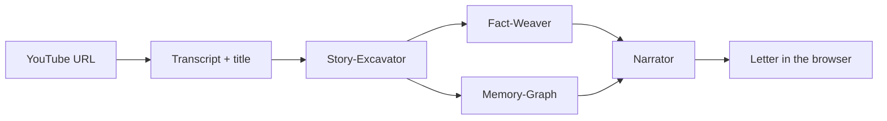

# Lantern

Lantern takes a YouTube video of a World War II veteran telling their story and turns it into an illustrated letter written in the veteran's voice, addressed to a future descendant. A chain of Claude agents reads the transcript, pulls out the story, checks the history, and writes the letter, while the browser shows each agent working in real time.

Built at the Claude Hackathon 2026 (April 2026) as a two-person team project.

## How it works



1. **Request.** The page (`src/app/page.tsx`) sends the YouTube URL to `POST /api/run` (`src/app/api/run/route.ts`). The route opens a Server-Sent Events stream and hands an `emit` function to the orchestrator, so every step can push events to the browser as it happens.

2. **Transcript.** `src/lib/transcript.ts` fetches the captions with the `youtube-transcript` package and, at the same time, calls YouTube's oEmbed endpoint for the video title and channel name (no API key needed). The title often contains the veteran's name, which the Narrator later uses for the signoff.

3. **Story-Excavator** (`src/lib/agents/excavator.ts`, Claude Sonnet). Reads the full transcript and calls a `save_fragment` tool once per piece of the story: a memory, place, person, date, emotion, quote or military unit. Each tool call is turned into a `fragment` event right away, so fragments appear on screen one by one.

4. **Fact-Weaver and Memory-Graph, in parallel.** The orchestrator (`src/lib/orchestrator.ts`) runs these two with `Promise.all` since both only need the fragments.
   - `src/lib/agents/factWeaver.ts` (Claude Sonnet) uses Anthropic's hosted web search tool to check units, battles, dates and places, and records each result with a `save_fact` tool as verified, uncertain or contradicted, with sources.
   - `src/lib/agents/memoryGraph.ts` (Claude Haiku) builds a small graph of people, places, events and units with `upsert_entity` and `link_entities` tools.

5. **Narrator** (`src/lib/agents/narrator.ts`, Claude Sonnet with adaptive thinking at low effort). Gets the full transcript plus the fragments, facts and entities, and writes the letter through a single `render_letter` tool call (salutation, sections with footnotes, signoff). The thinking stream is forwarded to the browser as `thinking` events. The salutation and the opening of the first section are then sent a word at a time as `letter_chunk` events so it looks like it is being typed, followed by the full `letter_complete` event.

6. **Image check.** Model-generated image URLs turned out to be guesses that 404, so the Narrator step throws them away. `src/lib/imageValidator.ts` instead picks one image from a short list of public-domain WW2 photos, chosen by counting keyword matches in the transcript and fragments (for example "normandy" or "pacific"), and attaches it to the first section.

7. **Rendering.** `src/lib/sse.ts` reads the stream on the client and feeds each event into a reducer in `page.tsx`. `AgentTrace.tsx` shows one live panel per agent, and `LetterRender.tsx` lays out the finished letter with its image, headings and clickable footnotes.

### Shared tool-call handling

All four agents use `src/lib/agents/streamHelper.ts`. It reads the Claude response stream, collects the partial JSON for each tool call, and fires a callback when a tool call is complete. This is what lets results show up while the model is still working instead of after the whole response finishes.

### Fallbacks

A recorded sample run lives in `src/fixtures/sample-norman.json`. It is used in a few places so the app never gets stuck:

- If `ANTHROPIC_API_KEY` is not set, the server replays the whole sample run.
- If one agent fails, only that agent's output is replaced with the sample data and the rest of the pipeline keeps going.
- If YouTube captions cannot be fetched, the sample transcript is used.
- The preset button on the page (and `?fixture=1` in the URL) plays the sample directly in the browser with no server call.

The event format shared by the frontend and backend is defined in `src/lib/types.ts` and described in `docs/02-API-CONTRACT.md`.

## Project layout

```
src/
  app/
    page.tsx            main screen: input, agent panels, letter
    api/run/route.ts    POST endpoint that streams pipeline events (SSE)
  components/           Hero, Lantern (animated SVG), AgentTrace, AgentPanel, LetterRender, small UI parts
  lib/
    orchestrator.ts     runs the agents in order and handles fallbacks
    transcript.ts       YouTube captions + oEmbed metadata
    prompts.ts          system prompts and tool schemas for each agent
    agents/             one file per Claude agent, plus the stream helper
    imageValidator.ts   picks a public-domain image by theme
    sse.ts              client-side stream reader and sample playback
    fixtures.ts         loads the sample run for the preset button
    types.ts            shared event and data types
  fixtures/             recorded sample run used for fallbacks
docs/                   planning docs written during the hackathon (architecture, API contract, prompts)
```

## Tech stack

- Next.js 16 (App Router), React 19, TypeScript
- Tailwind CSS 4
- Anthropic TypeScript SDK (`@anthropic-ai/sdk`): Claude Sonnet and Haiku, tool use, hosted web search, adaptive thinking
- `youtube-transcript` for captions, YouTube oEmbed for video metadata
- Server-Sent Events for streaming
- pnpm

## Running it

```bash
pnpm install
cp .env.example .env.local   # then add your Anthropic API key
pnpm dev
```

Open http://localhost:3000 and paste a YouTube link to a video that has captions.

Environment variables:

- `ANTHROPIC_API_KEY`: needed for the live pipeline. Without it, the server replays the recorded sample run.

Other scripts: `pnpm build`, `pnpm start`, `pnpm lint`.
